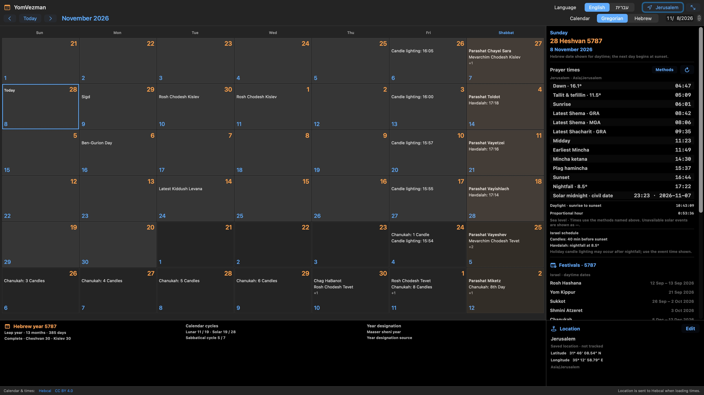

<p align="center">
  
</p>

# YomVezman

Hebrew dates, festivals and daily prayer times in a native Mac calendar.

**Public preview — 0.6.2-preview.1.** An early prerelease for testing, not a finished release or an App Store-approved build. [Website](https://webservices-org.github.io/yomvezman-releases/) · [Download and release notes](https://github.com/WEBServices-ORG/yomvezman-releases/releases/tag/v0.6.2-preview.1).

The DMG contains app version **0.6.2 (8)**. The preview label identifies this distribution; it does not change the signed app version.

## App preview

[](https://webservices-org.github.io/yomvezman-releases/assets/yomvezman-0.6.1-calendar.jpg)

YomVezman 0.6.1 · Jerusalem sample calendar. Open the image to view it at full size.

## Requirements

- A Mac with Apple silicon (M-series).
- macOS 14 or later.
- Internet access to load fresh calendar events and default prayer times. Previously loaded matching information can be used offline and is labeled as saved data.

## Install

1. Download the [Apple-silicon DMG](https://github.com/WEBServices-ORG/yomvezman-releases/releases/download/v0.6.2-preview.1/YomVezman-0.6.2-8-arm64.dmg).
2. Open the DMG and drag YomVezman to Applications.
3. Eject the disk image and open YomVezman from Applications.
4. Choose a city and timezone. Check the Israel/diaspora schedule, candle-lighting offset and Havdalah method for your practice.

This preview is Developer ID signed and notarized by Apple. Notarization is a security check; it is not App Store review or certification of calendar calculations. If macOS reports a damaged app, an unidentified developer or a failed security check, stop and contact support. Do not disable Gatekeeper or remove quarantine attributes to force the app open.

## Use

Browse Hebrew or Gregorian months with both dates displayed. Switch between English and Hebrew and use the window's full-screen control. Select a day for its events and prayer times. The year panel includes festival dates, Hebrew-year information and a traditional molad table.

Open Settings with Command-comma. Location edits are drafts until saved. Map and current-location lookup are optional; manual location entry is available. Display and menu-bar choices apply immediately. The optional menu-bar date follows sunset at the selected location; an asterisk indicates that sunset is unavailable and the daytime date is displayed.

To remove local calendar data, open Settings > Saved data > Remove saved calendar data. Read the confirmation before continuing. This removes saved location/preferences and downloaded source responses; you will need to choose a city again. It does not erase records held by Apple or Hebcal or change macOS location permission.

Calendar events and default times come from [Hebcal](https://www.hebcal.com/). Optional custom daily calculations run locally. Check the selected location, timezone and method against your community's practice. Unavailable solar events are shown explicitly.

## Updates

Choose YomVezman > Check for Updates to see available versions and release notes. Optional automatic checks at launch are off by default. In 0.4.0 and later, choose Update, then Install Update and Install and Relaunch. Versions through 0.3.0 require one manual DMG installation to gain this capability. Installation always requires confirmation.

## Support development

If you find YomVezman useful, you can [support its development via PayPal](https://www.paypal.com/ncp/payment/VRVYW4BB3CH3L). Contributions are optional.

## Support and privacy

For app support or privacy questions, email [beacons_mobile_9k@icloud.com](mailto:beacons_mobile_9k@icloud.com). Read the [privacy notice](https://webservices-org.github.io/yomvezman-releases/privacy.html). Do not post private locations, credentials or other sensitive information in public issue reports. Useful reports include the app version, macOS version, the steps taken and what happened.

## Repository scope

This repository distributes the Mac app and its website. The application's source repository is private. No affiliation with another calendar application or religious certification is claimed.

## Testing status and limitations

72 automated tests pass, including live calendar integration, calculation comparisons, polar-boundary cases and saved-data reset/recovery. Signature, notarization and packaged-copy Gatekeeper checks pass. Earlier signed-candidate launch and full-screen checks passed; the final 0.6.2 native launch check remains unverified. See release notes for remaining acceptance limits. The owner confirmed the visible menu-bar date/Open calendar path.

New in 0.6.2: Hebrew calendar cycle ratios now preserve the correct numeric order. Calendar calculations are unchanged. Final-candidate UI smoke was blocked by computer-use permission; the unchanged correction passed native English/Hebrew checks in the preceding development build.

Introduced in 0.6.1: About YomVezman is available from the application and date-status menus. It shows the running version/build, app icon, credits, bundled Sparkle license, privacy and support links. English/Hebrew layouts and keyboard dismissal passed native checks; status-item-only invocation and broader recovery checks remain open.

Acceptance checks still open: full Dock-free window lifecycle and recovery; first-use location permission grant/denial and arbitrary map-point input; spoken VoiceOver date editing; native same-process network failure/recovery; native reset error presentation. These are unverified paths, not claims of confirmed defects. Keep Dock mode enabled if you need the most thoroughly exercised launch path. App Store signing, privacy-label classification and submission are not complete.

SHA-256 (`YomVezman-0.6.2-8-arm64.dmg`):

```text
c8a3d06933eb643c02973f121bd87f352e411ec73bbb79f9d627efe776498341
```
